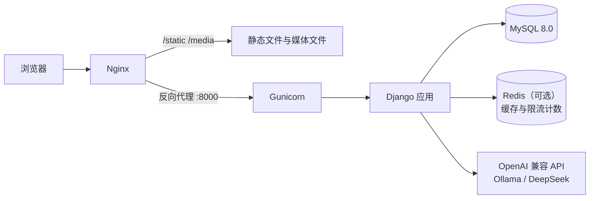
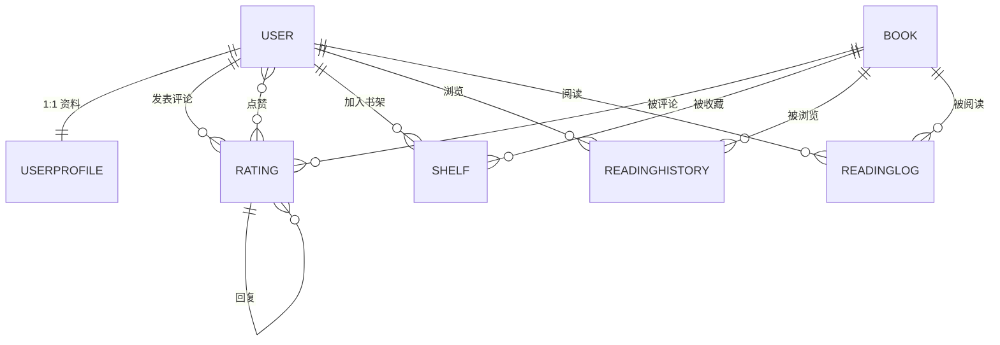

# 智能图书推荐与阅读分析系统


基于 Django + MySQL 的图书推荐与阅读管理平台，包含图书浏览与检索、评分评论、书架管理、
阅读行为统计、后台数据管理与 AI 个性化推荐。

## 功能

- **图书浏览与检索**：分类筛选、关键词搜索（书名 / 作者 / ISBN）、最低评分过滤
- **评分与评论**：星级评分、书评、回复、点赞
- **书架管理**：想读 / 在读 / 已读三种状态，记录阅读进度
- **阅读分析**：浏览历史、阅读时长统计、最近 7 天阅读趋势图表
- **用户体系**：注册、邮件字段、头像与个人资料、管理员审核
- **后台管理**：仪表盘（用户、图书、分类分布、热门图书）、图书增删改、批量导入、用户与评论管理
- **AI 推荐**：基于用户偏好与阅读历史的个性化推荐语、图书问答，接口带登录校验、每分钟限流与每日配额

## 技术栈

| 层次 | 技术 |
|---|---|
| 语言 / 框架 | Python 3.11、Django 5.2 |
| 数据库 | MySQL 8.0（InnoDB、utf8mb4） |
| 数据库驱动 | PyMySQL 1.1 |
| 缓存 | Redis（可选，多进程共享缓存与限流计数） |
| 前端 | Bootstrap 5.1、Bootstrap Icons、ECharts 5.3 |
| AI | OpenAI 兼容接口（默认云端 API，可切换本地 Ollama） |
| 部署 | Nginx + Gunicorn + systemd |
| 质量保障 | Django TestCase（23 个用例）、GitHub Actions |

## 系统架构



## 数据模型



七张业务表（不含 Django 自带的用户与会话表）：

| 表 | 说明 | 关键约束 |
|---|---|---|
| `books_book` | 图书 | `isbn` 唯一，`category` 索引 |
| `auth_user` / `books_userprofile` | 账号与资料 | 一对一，头像存储路径 |
| `books_rating` | 评分与书评 | 自关联 `parent` 实现回复；`(user, book, parent)` 唯一 |
| `books_rating_likes` | 评论点赞 | 多对多中间表 |
| `books_shelf` | 书架 | `(user, book)` 唯一 |
| `books_readinghistory` | 浏览历史 | `(user, book)` 唯一，按时间索引 |
| `books_readinglog` | 阅读时长 | 按 `(user, last_read_date)` 索引 |

## 关键优化

| 问题 | 处理方式 | 效果 |
|---|---|---|
| 书评详情页 N+1 查询 | `select_related` + `prefetch_related` + `annotate(Count)` | 8 条评论时 33 → 3 条 SQL；页面整体 22 → 16，且不随评论数增长 |
| `unique_together` 对 NULL 失效 | 应用层查重 + MySQL 函数唯一索引 `COALESCE(parent_id, 0)` + `IntegrityError` 兜底 | 顶级评论重复写入被数据库拒绝 |
| 关键字段缺索引 | 为 `category`、`viewed_at`、`(user, last_read_date)` 建索引 | `EXPLAIN`：`ALL` → `ref` / `range` |
| 函数包裹索引列 | `viewed_at__date__gte` 改为日期时间范围查询 | 浏览历史统计走 `rh_viewed_idx` |
| 个人资料页失效 | 修正模板 `related_name`，补齐 `nickname` / `bio` 字段 | 头像、昵称、简介可正常保存与显示 |
| 输入缺少校验 | 评分夹取到 1-5；头像限制大小与类型 | 异常请求不再产生 500 或脏数据 |
| AI 接口无鉴权、可被刷 | 登录校验 + 每分钟限流 + 每用户每日配额（数据库条件更新原子扣减） | 未登录请求被拒；超限返回 429，缓存命中不消耗配额 |

## 测试与持续集成

- 22 个 `TestCase`，覆盖评论唯一性（应用层与数据库约束）、N+1 查询数防回归、用户统计逻辑、
  书架与浏览历史去重、注册表单校验、评分夹取、后台权限、AI 接口鉴权与调用配额。
- GitHub Actions：每次推送自动启动 MySQL 8.0 服务容器，执行 `manage.py check` 与全部测试。

```bash
python manage.py test books
```

## 项目结构

```
BookRecommendSystem/
├── core/                         # 项目配置（settings / urls / wsgi / asgi）
├── books/                        # 业务应用
│   ├── models.py                 # 数据模型
│   ├── views.py                  # 视图与业务逻辑
│   ├── forms.py                  # 注册与图书表单
│   ├── recommender.py            # 协同过滤推荐
│   ├── admin.py                  # 后台模型注册
│   ├── tests.py                  # 单元测试
│   ├── management/commands/      # load_dataset 批量导入
│   ├── migrations/               # 数据库迁移
│   └── templates/                # 页面模板
├── .github/workflows/ci.yml      # 持续集成
├── media/                        # 封面等运行时文件
├── books.csv                     # 图书数据源
├── requirements.txt
└── manage.py
```

## 本地运行

### 1. 安装依赖

```bash
git clone https://github.com/llz888/BookRecommendSystem.git
cd BookRecommendSystem
python -m venv .venv
```

```bash
# Windows PowerShell
.\.venv\Scripts\Activate.ps1
# Linux / macOS
source .venv/bin/activate
```

```bash
pip install -r requirements.txt
```

### 2. 准备 MySQL

```sql
CREATE DATABASE books_db CHARACTER SET utf8mb4 COLLATE utf8mb4_0900_ai_ci;
CREATE USER 'book_user'@'localhost' IDENTIFIED BY 'BookDev_2026';
GRANT ALL PRIVILEGES ON books_db.* TO 'book_user'@'localhost';
-- 运行测试需要创建临时测试库
GRANT ALL PRIVILEGES ON `test_books_db`.* TO 'book_user'@'localhost';
FLUSH PRIVILEGES;
```

复制环境变量模板并填写本地数据库密码：

```bash
cp .env.example .env
```

`.env` 会被自动加载且不会提交到仓库。本地开发使用 `DJANGO_DEBUG=1`、`DB_PASSWORD=BookDev_2026`；未设置 `DJANGO_SECRET_KEY` 时开发模式会自动生成临时密钥，重启后需要重新登录。

需要 Redis（多进程共享缓存与限流计数）时启动容器，并在 `.env` 中取消 `REDIS_URL` 的注释：

```bash
docker run -d --name bookrec-redis -p 6379:6379 redis:7-alpine
```

### 3. 初始化数据

```bash
python manage.py migrate
python manage.py createsuperuser
python manage.py load_dataset
```

`load_dataset` 会从 `books.csv` 导入图书，并尝试抓取豆瓣短评（网络受限时会跳过）。
用户头像与电子书原文因隐私和版权原因未纳入仓库，电子书需放到 `media/book_texts/`。

### 4. 启动

```bash
python manage.py runserver
```

访问 http://127.0.0.1:8000/ ，后台为 http://127.0.0.1:8000/admin/ 。

## 环境变量

| 变量 | 默认值（开发） | 说明 |
|---|---|---|
| `DJANGO_DEBUG` | `1` | 生产环境必须设为 `0` |
| `DJANGO_SECRET_KEY` | 内置开发密钥 | 生产环境必须重新生成 |
| `DJANGO_ALLOWED_HOSTS` | `127.0.0.1,localhost` | 生产环境填写服务器 IP 或域名 |
| `DB_NAME` / `DB_USER` / `DB_PASSWORD` | `books_db` / `book_user` / 开发密码 | 数据库连接 |
| `DB_HOST` / `DB_PORT` | `127.0.0.1` / `3306` | 数据库地址 |
| `REDIS_URL` | 空 | 设置后缓存与限流计数走 Redis；为空时使用进程内缓存 |
| `AI_BASE_URL` | `https://api.deepseek.com/v1` | OpenAI 兼容接口地址，可改回本地 Ollama |
| `AI_API_KEY` | 空 | 云端 API 的 Key，未设置时 AI 功能返回友好提示 |
| `AI_MODEL` | `deepseek-chat` | 模型名称 |
| `AI_TIMEOUT` | `60` | 单次调用超时秒数 |
| `AI_RATE_LIMIT_PER_MIN` | `5` | 每用户每分钟调用上限 |
| `AI_DAILY_QUOTA` | `20` | 每用户每日调用上限 |

接入云端模型示例：

```
AI_BASE_URL=https://api.deepseek.com/v1
AI_API_KEY=sk-xxxxxxxx
AI_MODEL=deepseek-chat
```

## 部署

生产环境采用 Nginx + Gunicorn + systemd：

```bash
python manage.py collectstatic --noinput
.venv/bin/gunicorn core.wsgi:application --bind 127.0.0.1:8000 --workers 3
```

- systemd 通过 `EnvironmentFile` 注入 `.env`，设置 `DJANGO_DEBUG=0` 与 `DJANGO_ALLOWED_HOSTS`
- Nginx 负责 `/static/`、`/media/` 静态资源与反向代理，需设置
  `client_max_body_size 50m`（电子书上传）与 `proxy_read_timeout 300s`（AI 生成较慢）
- 会话使用数据库存储，多 worker 部署下登录状态不会丢失
- 在 `.env` 中配置 `AI_API_KEY`、`AI_DAILY_QUOTA` 与 `AI_RATE_LIMIT_PER_MIN`，控制模型调用成本

## 说明

- `media/avatars/` 与 `media/book_texts/` 未纳入仓库：前者含用户照片，后者为版权内容。
- 仓库中内置的数据库密码与 `SECRET_KEY` 仅用于本地开发，生产部署必须通过环境变量覆盖。
